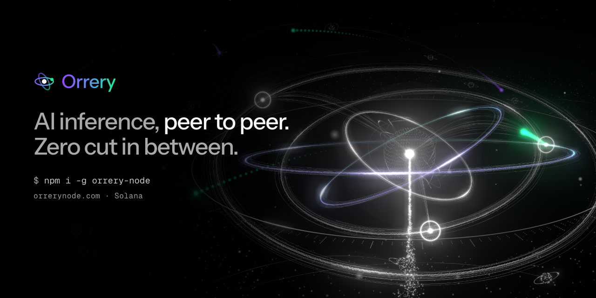
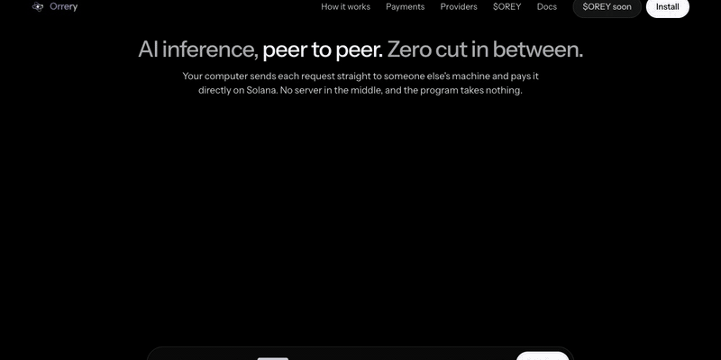
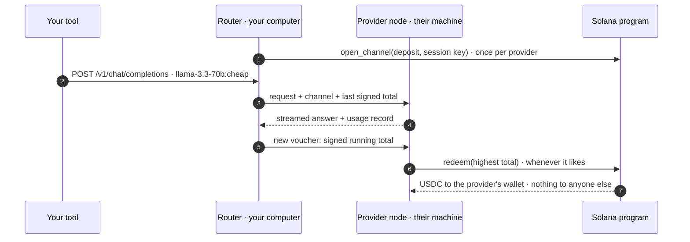
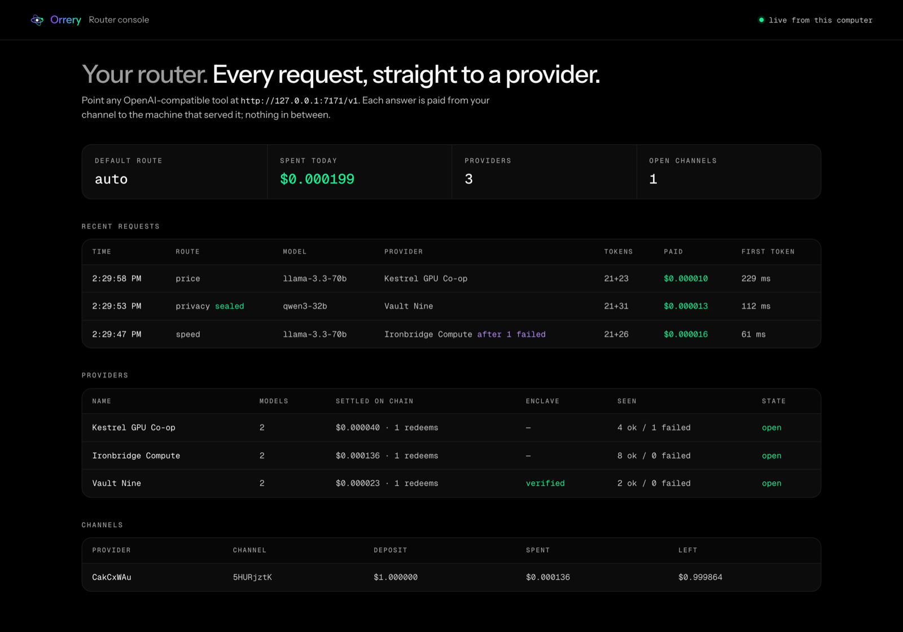

<p align="center">
  <a href="https://orrerynode.com"></a>
</p>

<h3 align="center">AI inference, peer to peer. Zero cut in between.</h3>

<p align="center">
  Your computer sends each request straight to someone else's machine and pays it directly on Solana.<br>
  No server in the middle, and the program takes nothing.
</p>

<p align="center">
  <a href="https://www.npmjs.com/package/orrery-node"></a>
  <a href="LICENSE"></a>
  <a href="docs/PROTOCOL.md"></a>
  
  
  
</p>

<p align="center">
  <a href="https://orrerynode.com"><b>Website</b></a>&nbsp;&nbsp;·&nbsp;&nbsp;<a href="https://orrerynode.com/docs"><b>Docs</b></a>&nbsp;&nbsp;·&nbsp;&nbsp;<a href="docs/PROTOCOL.md"><b>Protocol</b></a>&nbsp;&nbsp;·&nbsp;&nbsp;<a href="https://www.npmjs.com/package/orrery-node"><b>npm</b></a>&nbsp;&nbsp;·&nbsp;&nbsp;<a href="SECURITY.md"><b>Security</b></a>
</p>

<p align="center">
  
</p>

---

## Why

|  | A hosted AI gateway | **Orrery** |
|---|---|---|
| Where your request goes | through the gateway's servers | **straight from your computer to the provider's machine** |
| What sits in between | a company that takes a cut | **a Solana program with no fee field** |
| How you pay | an account and prepaid credits | **your own wallet, a signed running total per answer** |
| Who can sell inference | whoever the gateway approves | **anyone with a model and a URL; nobody can delist them** |
| What a provider risks | chargebacks, unpaid usage | **at most one answer: the next one is served only once the last is paid** |
| Private prompts | readable by whoever runs the box | **`:private` seals them to a verified hardware enclave** |

## Quick start

```bash
npm install -g orrery-node
orrery router --wallet ~/.config/solana/id.json --rpc <your RPC URL>
```

Then point anything that speaks the OpenAI API at the router. The API key can be any string.

```python
from openai import OpenAI

client = OpenAI(base_url="http://127.0.0.1:7171/v1", api_key="unused")
reply = client.chat.completions.create(
    model="llama-3.3-70b:cheap",          # add :cheap, :fast, :trusted or :private
    messages=[{"role": "user", "content": "Hello from the network"}],
)
```

Works unchanged with Cursor, Continue, Aider, Open WebUI, LangChain and the OpenAI SDKs. Every answer comes back with `x-orrery-provider`, `x-orrery-route` and `x-orrery-cost` headers. Full guide: **[orrerynode.com/docs](https://orrerynode.com/docs)**.

## How it works



1. **Providers list themselves on chain**: an endpoint, the key their node signs with, and the sha-256 of the price list it serves. No approval, no stake, no delisting.
2. **The router opens a channel** the first time it uses a provider: a small USDC deposit in an account only the channel controls, and a session key that never leaves your computer.
3. **After every answer** the router prices it from the provider's published list, takes the smaller of its number and the provider's, and signs a new running total: an 88-byte ed25519 voucher.
4. **The provider redeems** the highest total whenever it likes. The program pays exactly that difference to the provider's own token account. Whatever is not redeemed goes back to you when the channel closes.

Byte layouts, the routing formula and the threat table: **[docs/PROTOCOL.md](docs/PROTOCOL.md)**.

## Routes

| Suffix | Route | Picks |
|---|---|---|
| *(none)* | auto | blend of expected cost, first-token time and reputation |
| `:cheap` | price | lowest expected cost for this request |
| `:fast` | speed | fastest first token this router has measured |
| `:trusted` | reputation | most USDC settled on chain, redemptions, age, bonded $OREY, local success rate |
| `:private` | privacy | only providers whose enclave the router verified; the request is sealed (X25519 → HKDF → AES-256-GCM) |

The router tries the top three providers in order, so a slow or failing one is skipped without your tool noticing.

## Run a provider

Put a node in front of any OpenAI-compatible server — vLLM, SGLang, Ollama, llama.cpp, or API capacity you hold — set your prices, and list it. Routers anywhere can pay you per answer.

```bash
orrery provider register --config provider.json --wallet wallet.json   # list on chain (your wallet stays cold)
orrery provider start    --config provider.json                         # serve, check vouchers, redeem
```

```jsonc
{
  "name": "My GPU", "region": "eu-west", "publicUrl": "https://gpu.example.org",
  "upstream": { "baseUrl": "http://127.0.0.1:8000/v1" },
  "models": [{ "id": "llama-3.3-70b", "context": 131072, "maxOutput": 8192,
               "price": { "input": 120000, "output": 300000 } }]   // USDC base units per million tokens
}
```

Only standard chat fields reach your upstream, so a caller can never spend your key on models or tools your price list does not cover. The node runs on its own key, which can redeem but never touch what you have earned. Every field: [provider.json reference](https://orrerynode.com/docs#provider-config).

## Router console

The router serves a live console at `http://127.0.0.1:7171/`: every request, the provider that answered, tokens, what it cost, your providers and your channels.

<p align="center">
  
</p>

## Repository

```
program/   Anchor program (Rust) · provider registry, payment channels, ed25519 vouchers, enclave claims, bonds
node/      router + provider node (TypeScript, Node 22) · published to npm as orrery-node
web/       site and docs (Next.js, three.js)
docs/      protocol specification
assets/    brand and README media
```

## Build and test

```bash
cd program && anchor build --arch v2 && cargo test -p orrery   # 2 unit + 13 LiteSVM tests on the compiled program
cd node && pnpm install && pnpm test                            # 13 tests
pnpm e2e                                                        # full local rehearsal, 14 checks
cd web && pnpm install && pnpm dev                              # http://localhost:3870
```

The rehearsal deploys the program to a local validator, lists three providers in front of mock models, sends thirteen requests across every route, switches the cheapest provider off mid-run, redeems on chain, and checks that user + providers + open deposits equal the starting balance. The program takes nothing.

## Status

- [x] Settlement program: registry, channels, vouchers, enclave claims, bonds
- [x] Router and provider node, OpenAI-compatible, streaming
- [x] Local end-to-end rehearsal, 14 of 14 checks
- [x] npm package `orrery-node`
- [ ] Mainnet deployment and seed providers
- [ ] Verified build of the program
- [ ] Anthropic Messages API (`/v1/messages`)
- [ ] Built-in hardware attestation verifier

## Security

What each key can and cannot do, and how to report a vulnerability: **[SECURITY.md](SECURITY.md)**.

## License

[MIT](LICENSE)
