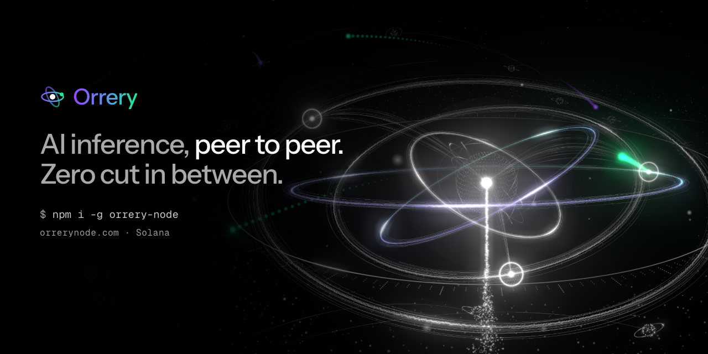
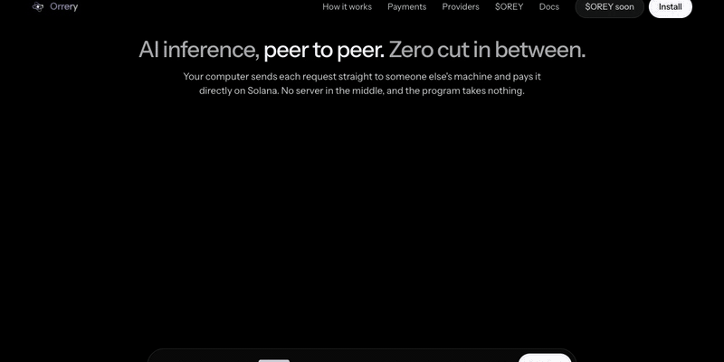

<p align="center">
  <a href="https://orrerynode.com"></a>
</p>

<h1 align="center">orrery-node</h1>

<h3 align="center">AI inference, peer to peer. Zero cut in between.</h3>

<p align="center">
  The router and provider node for <a href="https://orrerynode.com">Orrery</a>, a peer-to-peer AI inference network on Solana.<br>
  Your computer sends each request straight to someone else's machine and pays it per answer, directly on chain.<br>
  No server in the middle. No account. No API key to buy. The program takes nothing.
</p>

<p align="center">
  <a href="https://www.npmjs.com/package/orrery-node"></a>
  <a href="https://github.com/orrery-node/orrery/blob/main/LICENSE"></a>
  <a href="https://github.com/orrery-node/orrery"></a>
  
</p>

<p align="center">
  <a href="https://orrerynode.com"><b>Website</b></a>&nbsp;&nbsp;·&nbsp;&nbsp;<a href="https://orrerynode.com/docs"><b>Docs</b></a>&nbsp;&nbsp;·&nbsp;&nbsp;<a href="https://github.com/orrery-node/orrery"><b>GitHub</b></a>&nbsp;&nbsp;·&nbsp;&nbsp;<a href="https://github.com/orrery-node/orrery/blob/main/docs/PROTOCOL.md"><b>Protocol</b></a>&nbsp;&nbsp;·&nbsp;&nbsp;<a href="https://github.com/orrery-node/orrery/blob/main/SECURITY.md"><b>Security</b></a>
</p>

<p align="center">
  
</p>

---

## Install

```bash
npm install -g orrery-node      # Node.js 22 or newer
orrery help
```

or run it once with `npx -y orrery-node router --wallet <keypair.json>`.

## Use the network in 30 seconds

```bash
orrery router --wallet ~/.config/solana/orrery.json --rpc <your RPC URL> --daily-cap 5
```

```
Orrery router on http://127.0.0.1:7171/v1  ·  3 providers  ·  route auto  ·  wallet 7xKXtg…
session key 9WzDXw…AWWM signs vouchers; console at http://127.0.0.1:7171/
```

Point anything that speaks the OpenAI API at `http://127.0.0.1:7171/v1`. Any API key works: your wallet is the account.

```python
from openai import OpenAI

client = OpenAI(base_url="http://127.0.0.1:7171/v1", api_key="unused")
reply = client.chat.completions.create(
    model="llama-3.3-70b:cheap",          # :cheap  :fast  :trusted  :private
    messages=[{"role": "user", "content": "Hello from the network"}],
)
```

Works unchanged with **Cursor, Continue, Aider, Open WebUI, LangChain** and the **OpenAI SDKs**. Every answer comes back with `x-orrery-provider`, `x-orrery-route` and `x-orrery-cost`, and its `usage` carries the tokens the router paid for and `cost` in USDC (the field OpenRouter calls `usage.cost`). A stream ends with that usage chunk when the request sets `stream_options.include_usage`, as OpenAI's does, and has no usage chunk otherwise.

Embeddings work the same way: the router serves `/v1/embeddings`, routed to a provider that lists the embedding model and paid from the same channel, priced on input tokens (a provider lists an input price and an output price of 0).

Clients that speak the newer OpenAI Responses API work too: the router serves `/v1/responses` at the same base URL, streamed or not, with function calls.

The Codex CLI is one of them. One command writes a Codex profile for your router, beside your own `config.toml` and without touching it:

```bash
npx -y orrery-node connect codex --write      # writes ~/.codex/orrery.config.toml
codex --profile orrery
```

`orrery quote <model> --in 12000 --out 800` prices one request at every provider of a model from the lists on chain, cached rate included, without sending or paying anything.

`orrery bench <model> --n 3` asks every provider of a model a few short questions through your router, one provider at a time, and compares first-token time, total time and cost per answer against each listed price. An embedding model (listed on input tokens only) is asked through `/v1/embeddings`. Every ask is a real, paid request.

`orrery spend --since 24h --by model|provider` sums what your router paid, from the log it keeps of every answer it signs for (`~/.orrery/router/trips.jsonl`). The rehearsal checks that the log adds up to exactly what the router signed.

`orrery doctor` checks a setup without changing anything: it times the RPC, reads the program's config, fetches every listing's price list and checks it against the hash on chain, pings each node's `/health`, reads a wallet's SOL and USDC (`--wallet` or just `--address`) and looks for a local router.

A request can name fallbacks: `"model": "deepseek-v3|qwen3-32b"` or an OpenRouter-style `"models": [...]` (up to four). When no provider of one model can answer (none lists it, none fits the price ceiling, all cooling down or all failed before the first token) the router moves to the next, and logs why. The daily cap and bad requests still stop the request.

Four limits keep an unattended agent in bounds: `--max-price 0.50/1.50` (never route above a price per million tokens, after holder discounts; a request can set its own with `x-orrery-max-price`), `x-orrery-max-cost: 0.001` or `--max-cost` for every request (a dollar budget per request: only providers whose worst case, the full prompt plus every output token allowed, fits it are used), `--daily-cap` (refuse requests once the day's spending would pass it) and the channel deposit itself (a session key cannot sign past it).

`orrery provider compare --config provider.json` puts your price list next to every other listing of the same models on chain and says where each one stands on a typical request (cheapest of N, how far under the next, or that nobody else lists it), before you register or change prices.

On the provider side, `orrery provider earnings --config provider.json --since 24h` sums what the node billed, by model or by channel, from the log it keeps of every answer it serves (`served.jsonl` in its data directory). Routers sign the lower of a bill and their own math, so the console's signed total is the number that redeems.

Both sides get a local console. The router serves one at `http://127.0.0.1:7171/` (every answer, its provider, cost and why it went there), and a provider node serves one at its own port: answers served, totals signed by routers, what is redeemed on chain and what is waiting. The provider page answers only on that computer, and a request relayed by a proxy on the same machine gets a 404.

Coding agents resend their whole context every turn, and a provider's prompt cache only helps if the next turn comes back to it. The router remembers which provider last served each conversation prefix (for five minutes, about how long prompt caches last) and prices that provider's offer with the prefix as cached input. A provider that lists a cached-input price keeps the session when the cache makes it the cheaper choice.

Claude Code works the same way through the Anthropic API. Run the router with `--alias 'claude-*=gpt-oss-120b'` (any network model) and start Claude Code against it:

```bash
ANTHROPIC_BASE_URL=http://127.0.0.1:7171 ANTHROPIC_API_KEY=orrery claude
```

The router has no API key, so any value works. `orrery connect claude|openai|anthropic|mcp` prints what each client needs. The rehearsal runs Codex CLI 0.167.0 and Claude Code 2.1.301 through the router (`E2E_CODEX=1 E2E_CLAUDE=1 npx tsx devtools/e2e.ts`) and checks each answer was paid for.

Anthropic clients work too. The router serves the Anthropic Messages API at the same address, streamed or not, with tool use:

```python
from anthropic import Anthropic

client = Anthropic(base_url="http://127.0.0.1:7171", api_key="unused")
msg = client.messages.create(model="llama-3.3-70b", max_tokens=300,
                             messages=[{"role": "user", "content": "Explain a payment channel in two sentences."}])
print(msg.content[0].text)
```

Ask for a network model by name. Tool calls go to the provider as function calls and come back as `tool_use` blocks; payment is the same per-answer voucher.

If a client only sends its own model names, map them on the router: `orrery router --alias 'claude-*=llama-3.3-70b'` (comma-separate several, or set `ORRERY_ALIASES`).

### Agents: Orrery as an MCP server

`orrery mcp` runs an MCP server on stdio in front of your running router, so an agent can hand work to models on the network. It has four tools: `ask` (a model and a prompt, answered and paid per answer; an optional `max_price` like `0.50/1.50` caps what that call may pay per million tokens), `embed` (vectors from an embedding model on the network, paid per call), `models` (each model's lowest listed price, cached rate and context length) and `status`.

```json
{ "mcpServers": { "orrery": { "command": "npx", "args": ["-y", "orrery-node", "mcp"] } } }
```

Claude Code: `claude mcp add orrery -- npx -y orrery-node mcp`. Keep `orrery router` running; `--router <url>` points the MCP server at another one.

## One word picks the route

| Suffix | Picks |
|---|---|
| *(none)* | a blend of expected cost, first-token time and reputation |
| `:cheap` | lowest expected cost for this request |
| `:fast` | fastest first token this router has measured |
| `:trusted` | most USDC settled on chain, redemptions, age, bonded $OREY, local success rate |
| `:private` | only providers whose hardware enclave was verified; the prompt is sealed (X25519 → HKDF → AES-256-GCM) |

The router tries the top three providers in order, so a slow or dead one is skipped without your tool noticing.

## Pay per answer, not per account

- **One signature opens a channel.** Your wallet locks a small USDC deposit (`--deposit`, default 2) in an account only the channel controls.
- **Every answer is a signed running total.** A session key on your computer signs an 88-byte ed25519 voucher. The router prices each answer from the provider's published list and pays the smaller of its number and the provider's.
- **A router that loses its records picks its channels back up.** Keep `~/.orrery/router/session.json` and the rest can go (`orrery channels --wallet <keypair.json>` lists what the chain holds for you, including channels you have no record of): on first contact the router finds its open channel to that provider on chain, asks the node for the last voucher it holds (`GET /orrery/channel`), checks the signature is its own and that nothing beyond it is owed, and carries on from that total. Anything else and it opens a new channel.
- **Nobody is ever owed more than one answer.** A provider serves the next request only once the last is paid.
- **The rest comes back.** `orrery close <channel> --wallet <keypair>`, then `--finish` after the grace period.
- **`--daily-cap`** (default $5) stops all spending for the day.

## Sell inference from your own machine

Put a node in front of any OpenAI-compatible server — **vLLM, SGLang, Ollama, llama.cpp**, or API capacity you hold — set your prices, and list it. Routers anywhere can then pay you per answer. No application, no stake, and nothing in the program can delist you.

```bash
orrery provider init                                                   # find Ollama, vLLM, llama.cpp, LM Studio or SGLang and write provider.json
orrery provider register --config provider.json --wallet wallet.json   # list on chain; the wallet stays cold
orrery provider start    --config provider.json                         # serve, check vouchers, redeem
```

For vLLM and SGLang, `init` also lists a cached-input price (a quarter of the input price to start) for the prompt prefixes agents resend every turn. Turn on the server's cache report so hits reach Orrery: `--enable-prompt-tokens-details` for vLLM, `--enable-cache-report` for SGLang. Without a report every token is billed at the input price; a report can only lower a bill.

```jsonc
{
  "name": "My GPU", "region": "eu-west", "publicUrl": "https://gpu.example.org",
  "rpcUrl": "https://your-rpc.example.com", "settleMint": "EPjFWdd5AufqSSqeM2qN1xzybapC8G4wEGGkZwyTDt1v",
  "wallet": "~/.config/solana/provider-wallet.json",
  "upstream": { "baseUrl": "http://127.0.0.1:8000/v1" },
  "models": [{ "id": "llama-3.3-70b", "context": 131072, "maxOutput": 8192,
               "price": { "input": 120000, "output": 300000 } }]     // USDC base units per million tokens
}
```

Only standard chat fields reach your upstream, so a caller can never spend your key on models or tools your price list does not cover. The node runs on its own key, which can redeem but never send your earnings anywhere except your wallet.

## Hold $OREY, pay less

Providers can publish holder prices: hold a share of the network token's supply and they charge you less. Your router reads your balance and the supply from chain, ranks providers by the price you will actually pay, and signs at it; the provider checks the same numbers for the wallet that opened the channel. The seed provider's tiers: 0.1% of supply for 20% off, 1% for 35% off.

```jsonc
"holder": { "tiers": [{ "share": 10, "off": 2000 }, { "share": 100, "off": 3500 }] }   // basis points
```

## Commands

| Command | Does |
|---|---|
| `orrery mcp` | an MCP server on stdio for agents, in front of your running router (`--router`) |
| `orrery router` | run the router on `127.0.0.1:7171` (`--wallet`, `--rpc`, `--route`, `--deposit`, `--daily-cap`, `--alias`, `--port`) |
| `orrery models` | every model on the network, cheapest price, provider count |
| `orrery providers` | every listing and what the chain says about it |
| `orrery channels` | your channels: deposit, what you signed, what was redeemed |
| `orrery close <channel> [--finish]` | close a channel; the rest comes back to you |
| `orrery provider init \| register \| show \| start \| attest \| redeem` | run a provider (`init` finds a local model server and writes provider.json) |

The router also serves a live console at `http://127.0.0.1:7171/` with every request, the provider that answered and what it cost.

## How it fits together

```
your tool ──► router (your computer) ──────────────► provider's machine
                 │       request · answer · signed total        │
                 └──── Solana program: channel deposit · redeem ─┘
```

The Solana program (`7UHevY47LgbJv9hz4iymecR8FURy27jX55KYb1sxytZS`) only holds channel deposits and pays out signed totals. It has no fee field and no third recipient, and nobody, including the admin, can delist a provider. Byte layouts and the threat table are in the [protocol spec](https://github.com/orrery-node/orrery/blob/main/docs/PROTOCOL.md).

## Links

- Website: https://orrerynode.com
- Docs: https://orrerynode.com/docs
- Source: https://github.com/orrery-node/orrery
- X: https://x.com/OrreryNode
- Security: https://github.com/orrery-node/orrery/blob/main/SECURITY.md

MIT licensed.
